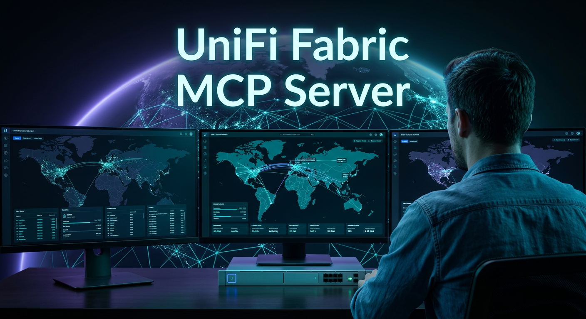
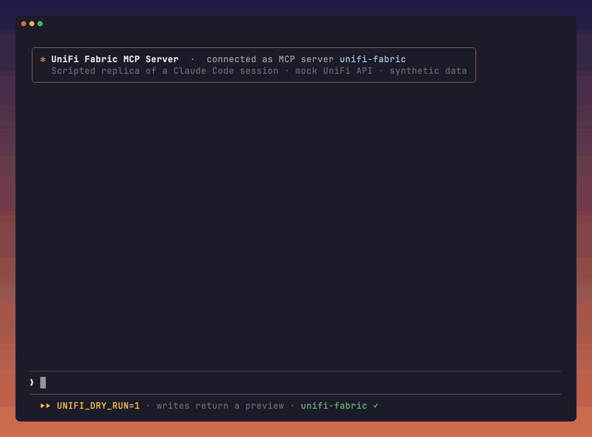
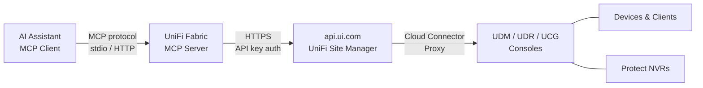

# UniFi Fabric MCP Server

<!-- mcp-name: io.github.swkstudios/unifi-fabric-mcp-server -->

[](https://github.com/swkstudios/unifi-fabric-mcp-server/actions/workflows/ci.yml)
[](https://pypi.org/project/unifi-fabric-mcp-server/)
[](https://www.python.org/)
[](https://opensource.org/licenses/MIT)
[](https://registry.modelcontextprotocol.io/?q=io.github.swkstudios%2Funifi-fabric-mcp-server)

**Manage your entire UniFi network remotely from any AI assistant, through the UniFi Fabric API in Ubiquiti's cloud. Nothing to install on your network, no controller login.** 786 tools across Site Manager, Network, Protect, InnerSpace and more, read-only if you want.



*Scripted replica of a Claude Code session: real MCP tool calls to this server against a mock UniFi API with synthetic data, writes in dry-run mode ([how it's made and how to reproduce it](scripts/demo/README.md)).*

| How it connects | |
|---|---|
| Runs on | Your machine, with your own UniFi API key |
| Talks to | The UniFi Fabric API in Ubiquiti's cloud (api.ui.com), and nothing else |
| Needs | No SSH, no controller access, nothing on your LAN |

By default the client sees 5 discovery meta-tools that reach every tool; see [Discovery mode](#discovery-mode-default).

### Why this server

- Remote management through the UniFi Fabric API in Ubiquiti's cloud.
- 786 tools across Site Manager, Network, Protect, InnerSpace, Mobility and Carrier Fabric.
- Discovery mode advertises 5 tools in about 5 KB while reaching the full catalog; full mode uses about 1454 KB.
- Pass-through tools preserve upstream fields by default; projections and summaries are documented. Configured server secrets are masked and data-secret redaction is optional.
- Choose read-only mode, dry-run previews, redaction and audit logging.
- Every tool runs in CI against a simulated upstream.
- Works with MCP clients and is MIT licensed. See [MSP setup and demos](docs/MSP.md).

**Contents:** [Quick Start](#quick-start) · [Safety](#safety-controls-you-set) · [Read-only mode](#read-only-mode) · [Examples](#example-prompts) · [Clients](#set-up-your-client) · [Tools](#available-tools) · [Configuration](#configuration) · [Troubleshooting](#troubleshooting) · [Contributing](#contributing)

> **Disclaimer:** This project is not affiliated with, endorsed by, or sponsored by Ubiquiti Inc. UniFi is a trademark of Ubiquiti Inc.

The canonical console command is `unifi-fabric-mcp`. The MCP Registry also launches the
equivalent `unifi-fabric-mcp-server` console alias, matching the PyPI package identifier.

## Quick Start

1. [Get a UniFi API key](#get-your-api-key). Enable Site Manager and Network scopes at minimum, plus Protect for cameras.
2. In Claude Code, run `/plugin marketplace add swkstudios/unifi-fabric-mcp-server` and then `/plugin install unifi-fabric@unifi-fabric`. The plugin requires [uv](https://docs.astral.sh/uv/) and prompts for the key.
3. Ask: "List my UniFi sites and the devices in each one."

### Choose your client

Local stdio setups use [uv](https://docs.astral.sh/uv/); Docker deployments need Docker instead. Set `UNIFI_API_KEY` in your environment before using the CLI commands. Configuration files may store keys in plain text; keep them private.

| Client or distribution | Setup |
|---|---|
| Claude Code plugin | `/plugin marketplace add swkstudios/unifi-fabric-mcp-server`, then `/plugin install unifi-fabric@unifi-fabric` |
| Claude Code MCP | `claude mcp add unifi-fabric -e UNIFI_API_KEY="$UNIFI_API_KEY" -- uvx --from unifi-fabric-mcp-server==0.7.0 unifi-fabric-mcp` |
| Claude Desktop | [Download the .mcpb from the latest release](https://github.com/swkstudios/unifi-fabric-mcp-server/releases/latest) and double-click it; [details](#use-with-claude-desktop) |
| Codex | `codex mcp add unifi-fabric --env UNIFI_API_KEY="$UNIFI_API_KEY" -- uvx --from unifi-fabric-mcp-server==0.7.0 unifi-fabric-mcp` |
| Antigravity CLI | `agy mcp add unifi-fabric -- uvx --from unifi-fabric-mcp-server==0.7.0 unifi-fabric-mcp`; [IDE setup](#use-with-google-antigravity) |
| Gemini CLI | `gemini extensions install https://github.com/swkstudios/unifi-fabric-mcp-server` |
| VS Code and Cursor | [Other client setup](#track-a--local-stdio) |
| ChatGPT | [Self-hosted HTTPS and OAuth](#use-with-chatgpt-self-hosted) |
| Other MCP clients | [stdio](#track-a--local-stdio) / [HTTP](#track-b--docker-http) |
| uvx | `uvx --from unifi-fabric-mcp-server==0.7.0 unifi-fabric-mcp` |
| pipx | `pipx install unifi-fabric-mcp-server==0.7.0` |
| pip | `pip install unifi-fabric-mcp-server==0.7.0` |
| Docker | `docker pull ghcr.io/swkstudios/unifi-fabric-mcp-server:0.7.0`; [deployment](#docker-deployment) |
| MCP Registry | [io.github.swkstudios/unifi-fabric-mcp-server](https://registry.modelcontextprotocol.io/?q=io.github.swkstudios%2Funifi-fabric-mcp-server) |

### Get Your API Key

1. Sign in to [UniFi Site Manager](https://unifi.ui.com) with your Ubiquiti account
2. Select your organization from the dropdown (top-left)
3. In the left sidebar, click **API Keys**
4. Click **Create New API Key** and give it a descriptive name
5. Select the **API Scope** — enable **Site Manager** and **Network** at minimum (add **Protect** if managing cameras)
6. Under **Sites**, choose which sites the key can access (or select all)
7. Copy the key immediately — it won't be shown again

> **Note:** These are UniFi Site Manager API keys that authenticate against the UniFi Fabric API in Ubiquiti's cloud (`api.ui.com`). Your consoles must be adopted to your UI.com account and connected to Ubiquiti's cloud for the key to discover them. See the [API Docs](https://developer.ui.com) for more details.

<a id="safety-defaults"></a>

## Safety controls you set

**Always on:** Every read tool is marked read-only and every write tool is marked destructive, derived from code and checked by tests. Supporting clients can use these hints to distinguish reads from writes. Use your client permission settings to ask before a write. The server masks its own UniFi API key when UniFi echoes it, and in errors and logs. A dry-run preview can echo a key that the caller supplied in the request body. The optional `confirm` argument is accepted and ignored; it is not an approval control. In discovery mode, all writes go through `call_write_tool`; choosing "do not ask again" for it may approve every later write.

Full access is the default because the server exists to manage your network. To start cautiously, turn on read-only mode first. These switches are opt-in and off by default; set them in the client server environment:

| Setting | What it does |
|---|---|
| `UNIFI_READ_ONLY=1` | Hides write and action tools from the catalog and refuses them if called. See [Read-only mode](#read-only-mode). |
| `UNIFI_REDACT_SECRETS=1` | Data secrets such as Wi-Fi passwords are returned as UniFi sends them unless this is on; it masks documented credential fields in responses. See [Credential redaction](docs/CONFIGURATION.md#credential-redaction). |
| `UNIFI_DRY_RUN=1` | Returns a preview of every write instead of sending it. See [Dry-run](#dry-run-preview-for-all-writes-unifi_dry_run). |
| `UNIFI_AUDIT_LOG=/path` | Appends one line per write attempt to a local file. See [Audit log](#optional-audit-log-unifi_audit_log). |

## Read-only mode

Set `UNIFI_READ_ONLY=1` to hide write and action tools and refuse calls before they reach UniFi. Reads remain available. Turn on the Claude Code plugin Read-only mode option, add the variable to a client configuration or pass `-e UNIFI_READ_ONLY=1` to Docker. Remove it or turn the plugin option off and restart to enable writes again.

For example, with Claude Code:

<!-- install-case: readme-install-01 mode=non-executable reason=client-interaction-or-deployment-step-requires-user-setup -->
<!-- doc-provenance: source=file:scripts/extract_install_cases.py@sha256:28801c0956bd864ce308d568a20859b4ec881331cc627b23ffef6d1b80fc9458 support=0.7.0 case=readme-install-01 -->
```bash
export UNIFI_API_KEY="your-api-key-here"
claude mcp add unifi-fabric -e UNIFI_API_KEY="$UNIFI_API_KEY" -e UNIFI_READ_ONLY=1 -- uvx --from unifi-fabric-mcp-server==0.7.0 unifi-fabric-mcp
```

The command stores the key in Claude Code's MCP configuration in plain text; keep it private. See [read-only details](#read-only-mode-details) for accepted values, selection order and per-area flags.

## Example Prompts

Copy-paste these into Claude Code or any MCP client after connecting:

```
Show me a summary of all devices and clients across my sites.
```

```
Are there any offline devices? List them with their site names.
```

```
Create a firewall policy that blocks traffic from the guest VLAN to the server VLAN.
```

```
List all firewall policies and show their current ordering.
```

```
Get the RTSPS stream URLs for cameras in the main office.
```

```
How many clients are connected to each site right now?
```

### Sample Tool Output

When you ask the MCP server a question, it executes tools and returns structured data. Here is `get_fleet_summary` on a single console with one site and five devices (output from a sanitized recorded response; it returns counts only, no records):

```json
{
  "hosts": 1,
  "sites": 1,
  "devices": {
    "total": 5,
    "byStatus": {
      "online": 5
    },
    "byType": {
      "protect": 3,
      "network": 2
    }
  },
  "_key_label": null
}
```

With several API keys configured, the summary also carries `_key_labels` (the labels of the keys that answered), `_keyTotals` (each answering key's share of the counts, summing to the totals), and `errors` for a key that failed; `incomplete` / `incompleteReason` appear when a list stopped at the opt-in `UNIFI_PAGINATE_MAX_PAGES` cap.

## Set up your client

The [Quick Start](#choose-your-client) table links here. Every option runs the server on your own machine with your own UniFi API key; nothing goes through a hosted service, and requests go from your machine to `api.ui.com` only.

### Install as a Claude Code plugin

The [`plugins/claude/`](plugins/claude/) folder is a Claude Code plugin. It runs this server locally through `uvx` with the API key you enter when you enable it (kept in Claude Code's secure credential storage), and it has optional Read-only mode and Tool mode settings. Nothing goes through a hosted service: requests go from your machine to `api.ui.com` only. It works in Claude Code (terminal, IDE extensions and the desktop Code tab). Claude Desktop chat runs local servers configured through `claude_desktop_config.json`; see [Use with Claude Desktop](#use-with-claude-desktop). The claude.ai web and mobile chat clients do not run local MCP servers. See the [plugin README](plugins/claude/README.md) for what it runs, where data goes, and example prompts, and [PRIVACY.md](PRIVACY.md) for the privacy policy.

Install it from this repository's marketplace (Claude Code 2.1.275 or later installs in one step):

<!-- install-case: readme-install-09 mode=plugin -->
<!-- doc-provenance: source=file:scripts/extract_install_cases.py@sha256:28801c0956bd864ce308d568a20859b4ec881331cc627b23ffef6d1b80fc9458 support=0.7.0 case=readme-install-09 -->
```text
/plugin marketplace add swkstudios/unifi-fabric-mcp-server
/plugin install unifi-fabric@unifi-fabric
```

Claude Code asks for your API key, Read-only mode and Tool mode (discovery by default) when you enable it. Or try it for one session from a checkout:

<!-- install-case: readme-install-10 mode=plugin -->
<!-- doc-provenance: source=file:scripts/extract_install_cases.py@sha256:28801c0956bd864ce308d568a20859b4ec881331cc627b23ffef6d1b80fc9458 support=0.7.0 case=readme-install-10 -->
```bash
claude --plugin-dir ./plugins/claude
```

Without the plugin, register the server directly with `claude mcp add` as shown in [Safety defaults](#safety-defaults) or [Track A](#track-a--local-stdio).

### Use with Claude Desktop

Claude Desktop chat runs local MCP servers from its config file (macOS and Windows; not claude.ai on the web or mobile). Open it with **Settings > Developer > Edit Config**:

- macOS: `~/Library/Application Support/Claude/claude_desktop_config.json`
- Windows: `%APPDATA%\Claude\claude_desktop_config.json`

<!-- install-case: readme-install-11 mode=desktop -->
<!-- doc-provenance: source=file:scripts/extract_install_cases.py@sha256:28801c0956bd864ce308d568a20859b4ec881331cc627b23ffef6d1b80fc9458 support=0.7.0 case=readme-install-11 -->
```json
{
  "mcpServers": {
    "unifi-fabric": {
      "command": "/absolute/path/to/uvx",
      "args": ["--from", "unifi-fabric-mcp-server==0.7.0", "unifi-fabric-mcp"],
      "env": { "UNIFI_API_KEY": "your-api-key-here" }
    }
  }
}
```

Replace `/absolute/path/to/uvx` with the output of `which uvx` (macOS) or `where uvx` (Windows): an app started from the Dock or Start menu may not see `~/.local/bin` or other shell `PATH` entries. Add `"UNIFI_READ_ONLY": "1"` to `env` to hide and refuse every write and action tool. Then quit Claude Desktop completely and start it again. The key sits in this file in plain text, so keep the file private.

On macOS or Windows you can instead install the Claude Desktop extension bundle (`.mcpb`), built from [`plugins/claude-desktop/`](plugins/claude-desktop/): Claude Desktop asks for the key at install time and keeps it in its secure storage. See the [bundle README](plugins/claude-desktop/README.md).

### Use with OpenAI Codex

The Codex CLI, the Codex IDE extension and the ChatGPT desktop app share `~/.codex/config.toml`, so one setup serves all three. ChatGPT on the web cannot start local servers; see [Use with ChatGPT (self-hosted)](#use-with-chatgpt-self-hosted).

**Recommended: forward the key from your environment (nothing stored).** Add this to `~/.codex/config.toml`:

<!-- install-case: readme-install-12 mode=codex -->
<!-- doc-provenance: source=file:scripts/extract_install_cases.py@sha256:28801c0956bd864ce308d568a20859b4ec881331cc627b23ffef6d1b80fc9458 support=0.7.0 case=readme-install-12 -->
```toml
[mcp_servers.unifi-fabric]
command = "uvx"
args = ["--from", "unifi-fabric-mcp-server==0.7.0", "unifi-fabric-mcp"]
env_vars = ["UNIFI_API_KEY", "UNIFI_READ_ONLY"]   # forwarded from the environment Codex starts in
```

Then start Codex from a shell that has the key (the `read` keeps it out of your shell history):

<!-- install-case: readme-install-13 mode=non-executable reason=client-interaction-or-deployment-step-requires-user-setup -->
<!-- doc-provenance: source=file:scripts/extract_install_cases.py@sha256:28801c0956bd864ce308d568a20859b4ec881331cc627b23ffef6d1b80fc9458 support=0.7.0 case=readme-install-13 -->
```bash
printf 'UniFi API key: '; read -rs UNIFI_API_KEY; echo; export UNIFI_API_KEY
export UNIFI_READ_ONLY=1   # optional: read-only mode
codex
```

**One-liner (stores the key in `config.toml` in plain text):**

<!-- install-case: readme-install-14 mode=non-executable reason=client-interaction-or-deployment-step-requires-user-setup -->
<!-- doc-provenance: source=file:scripts/extract_install_cases.py@sha256:28801c0956bd864ce308d568a20859b4ec881331cc627b23ffef6d1b80fc9458 support=0.7.0 case=readme-install-14 -->
```bash
printf 'UniFi API key: '; read -rs UNIFI_API_KEY; echo
codex mcp add unifi-fabric --env UNIFI_API_KEY="$UNIFI_API_KEY" -- uvx --from unifi-fabric-mcp-server==0.7.0 unifi-fabric-mcp
```

Add `--env UNIFI_READ_ONLY=1` for read-only mode. `codex mcp list` shows the server.

**ChatGPT desktop app:** it reads the same `config.toml`, and its servers are listed under **Settings > MCP servers** (**Add server** for a new one, then **Restart**). An app started from the Dock or Finder does not see variables exported in a terminal, so `env_vars` forwarding only works when Codex starts from a shell; for the desktop app, give the key with the one-liner above (or an `env = { UNIFI_API_KEY = "your-api-key-here" }` line in the `[mcp_servers.unifi-fabric]` table).

**Codex plugin:** this repository is also a Codex plugin marketplace ([`plugins/codex/`](plugins/codex/)). The plugin stores no key; it forwards `UNIFI_API_KEY`, `UNIFI_READ_ONLY` and `UNIFI_TOOL_MODE` from the environment Codex starts in:

<!-- install-case: readme-install-15 mode=non-executable reason=client-interaction-or-deployment-step-requires-user-setup -->
<!-- doc-provenance: source=file:scripts/extract_install_cases.py@sha256:28801c0956bd864ce308d568a20859b4ec881331cc627b23ffef6d1b80fc9458 support=0.7.0 case=readme-install-15 -->
```bash
codex plugin marketplace add swkstudios/unifi-fabric-mcp-server
codex plugin add unifi-fabric@unifi-fabric
```

With no key in the environment the server exits at startup and Codex lists no unifi-fabric tools; a wrong key returns the upstream `HTTP 401` on the first tool call.

### Use with Google Antigravity

Antigravity starts local servers with the environment of the shell that started `agy`, and it does not expand `${VAR}` in `env` values. Keep the key out of config files by exporting it before you start `agy`:

<!-- install-case: readme-install-16 mode=antigravity -->
<!-- doc-provenance: source=file:scripts/extract_install_cases.py@sha256:28801c0956bd864ce308d568a20859b4ec881331cc627b23ffef6d1b80fc9458 support=0.7.0 case=readme-install-16 -->
```bash
printf 'UniFi API key: '; read -rs UNIFI_API_KEY; echo; export UNIFI_API_KEY
export UNIFI_READ_ONLY=1   # optional: read-only mode
agy mcp add unifi-fabric -- uvx --from unifi-fabric-mcp-server==0.7.0 unifi-fabric-mcp
agy
```

Or install the plugin from a checkout of this repository; it uses the same exported key:

<!-- install-case: readme-install-17 mode=antigravity -->
<!-- doc-provenance: source=file:scripts/extract_install_cases.py@sha256:28801c0956bd864ce308d568a20859b4ec881331cc627b23ffef6d1b80fc9458 support=0.7.0 case=readme-install-17 -->
```bash
agy plugin install ./plugins/antigravity
```

Antigravity 2.0 and the Antigravity IDE read the same `~/.gemini/config`, but when started from the Dock they do not see variables exported in a terminal. For them, store the key in the config instead (in plain text, in `~/.gemini/config/mcp_config.json`):

<!-- install-case: readme-install-18 mode=antigravity -->
<!-- doc-provenance: source=file:scripts/extract_install_cases.py@sha256:28801c0956bd864ce308d568a20859b4ec881331cc627b23ffef6d1b80fc9458 support=0.7.0 case=readme-install-18 -->
```bash
agy mcp add --env UNIFI_API_KEY="$UNIFI_API_KEY" unifi-fabric -- uvx --from unifi-fabric-mcp-server==0.7.0 unifi-fabric-mcp
```

Without a key the server exits at startup and Antigravity lists no unifi-fabric tools; a wrong key returns the upstream `HTTP 401` on the first tool call. See the [plugin README](plugins/antigravity/README.md).

### Use with Gemini CLI

Google replaced the consumer Gemini CLI with Antigravity; Gemini CLI remains available to Enterprise and API-key users. This repository's root [`gemini-extension.json`](gemini-extension.json) makes it a Gemini CLI extension that prompts at install time for your API key (stored in the system keychain) and the optional Read-only mode and Tool mode settings:

<!-- install-case: readme-install-19 mode=non-executable reason=client-interaction-or-deployment-step-requires-user-setup -->
<!-- doc-provenance: source=file:scripts/extract_install_cases.py@sha256:28801c0956bd864ce308d568a20859b4ec881331cc627b23ffef6d1b80fc9458 support=0.7.0 case=readme-install-19 -->
```bash
gemini extensions install https://github.com/swkstudios/unifi-fabric-mcp-server
```

We have checked the manifest against the [extension reference](https://geminicli.com/docs/extensions/reference/) but have not run it in Gemini CLI. Antigravity's `agy plugin import` also reads this manifest.

### Use with ChatGPT (self-hosted)

ChatGPT on the web and in its apps only connects to remote MCP servers over HTTPS, signed in with OAuth 2.1; it cannot start a local server or send an API key. You can still use this server with ChatGPT by hosting **your own** instance in OAuth mode behind your own identity provider and adding it as a custom MCP server. Never put this write-capable server on a public URL without authentication. The [self-hosted ChatGPT guide](docs/CHATGPT.md) has the prerequisites, steps, a known limitation and a security checklist; that setup has not been tested end to end with ChatGPT.

A listing in the ChatGPT app directory would need a hosted service run by us. We do not run one, so there is no directory listing.

### Track A — Local (stdio)

Install from PyPI and run the server locally. The MCP client launches it as a subprocess over stdio. **Requires Python 3.12+** (or [uv](https://docs.astral.sh/uv/), which fetches a suitable Python for you).

<!-- install-case: readme-install-20 mode=uvx -->
<!-- doc-provenance: source=file:scripts/extract_install_cases.py@sha256:28801c0956bd864ce308d568a20859b4ec881331cc627b23ffef6d1b80fc9458 support=0.7.0 case=readme-install-20 -->
<!-- docs-fact: run -->
```bash
export UNIFI_API_KEY="your-api-key-here"
uvx --from unifi-fabric-mcp-server==0.7.0 unifi-fabric-mcp
```

Or install it once in an isolated environment:

<!-- install-case: readme-install-21 mode=pipx -->
<!-- doc-provenance: source=file:scripts/extract_install_cases.py@sha256:28801c0956bd864ce308d568a20859b4ec881331cc627b23ffef6d1b80fc9458 support=0.7.0 case=readme-install-21 -->
<!-- docs-fact: run -->
```bash
pipx install unifi-fabric-mcp-server==0.7.0
unifi-fabric-mcp
```

Or use a virtual environment you manage:

<!-- install-case: readme-install-22 mode=pip -->
<!-- doc-provenance: source=file:scripts/extract_install_cases.py@sha256:28801c0956bd864ce308d568a20859b4ec881331cc627b23ffef6d1b80fc9458 support=0.7.0 case=readme-install-22 -->
```bash
python3 -m venv .venv
.venv/bin/python -m pip install unifi-fabric-mcp-server==0.7.0
.venv/bin/unifi-fabric-mcp
```

For Claude Code, put this in `.mcp.json` at your project root (Claude Code asks you to approve it on first use). To register the server for all your projects, use `claude mcp add --scope user unifi-fabric -e UNIFI_API_KEY=… -- uvx --from unifi-fabric-mcp-server==0.7.0 unifi-fabric-mcp`; Claude Code stores that configuration in `~/.claude.json`. Supported locations are documented by [Claude Code](https://code.claude.com/docs/en/mcp).

<!-- install-case: readme-install-23 mode=desktop -->
<!-- doc-provenance: source=file:scripts/extract_install_cases.py@sha256:28801c0956bd864ce308d568a20859b4ec881331cc627b23ffef6d1b80fc9458 support=0.7.0 case=readme-install-23 -->
```json
{
  "mcpServers": {
    "unifi-fabric": {
      "command": "uvx",
      "args": ["--from", "unifi-fabric-mcp-server==0.7.0", "unifi-fabric-mcp"],
      "env": { "UNIFI_API_KEY": "your-api-key-here" }
    }
  }
}
```

If you installed with `pipx` or `pip` instead, use `"command": "unifi-fabric-mcp"` and omit `args`.

> **PATH note:** A bare `"command": "unifi-fabric-mcp"` only resolves if it is on the MCP client's `PATH`. Many MCP clients do not inherit the shell's virtual environment. Use `uvx` as above, the absolute path to the installed binary (for example `/path/to/.venv/bin/unifi-fabric-mcp`), or install globally with `pipx install unifi-fabric-mcp-server==0.7.0` or `uv tool install unifi-fabric-mcp-server==0.7.0`.

**Homebrew:** a Homebrew formula is planned, but there is no tap yet; follow [issue #24](https://github.com/swkstudios/unifi-fabric-mcp-server/issues/24).

**Verify it works:** When launched by the client the server exits immediately if `UNIFI_API_KEY` is absent or empty; an incorrect key will not prevent startup but will cause tool calls to fail with an authentication error. A successful start produces no output on stdio (the client communicates over stdin/stdout).

### Track B — Docker (HTTP)

See [Docker HTTP setup and verification](docs/DOCKER.md#track-b-docker-http).

<a id="unauthenticated-http-trusted-network-only"></a>

### Track C — From source (development)

<!-- install-case: readme-install-28 mode=source -->
<!-- doc-provenance: source=file:scripts/extract_install_cases.py@sha256:28801c0956bd864ce308d568a20859b4ec881331cc627b23ffef6d1b80fc9458 support=0.7.0 case=readme-install-28 -->
```bash
git clone https://github.com/swkstudios/unifi-fabric-mcp-server.git
cd unifi-fabric-mcp-server
python3 -m venv .venv && source .venv/bin/activate
pip install -e .          # -e is editable/dev mode
export UNIFI_API_KEY="your-api-key-here"
unifi-fabric-mcp
```

## Agent skills

The [`skills/`](skills/) folder holds six workflow skills: firewall zone and policy audit,
network or VLAN change, device and client troubleshooting, Protect camera and event review,
Wi-Fi radio change, and site health report. Each tells the agent which tools to call and in
which order: reads first, the exact change shown to you, the tool's own dry-run preview where it
has one, the write, then a read-back. The Claude Code plugin loads them; for Claude Desktop,
Codex, Gemini CLI and Antigravity see [docs/AGENT-SKILLS.md](docs/AGENT-SKILLS.md).

## About this server

**What is UniFi Fabric?** Ubiquiti spells it "UniFi Fabrics" and describes it as: "UniFi Fabrics transforms Site Manager into a single control plane built for unlimited scale of sites and users." (Ubiquiti, [Introducing UniFi Fabrics](https://blog.ui.com/article/introducing-unifi-fabrics), 2026-01-12). Watch Ubiquiti's own video, [Introducing: UniFi Fabrics](https://www.youtube.com/watch?v=69g3O3Ltygw), or read [The New Site Manager - Now Official](https://blog.ui.com/article/officially-bringing-unifi-fabrics).

This is an MCP (Model Context Protocol) server that exposes the UniFi Site Manager API as tools for AI assistants. Built with [FastMCP](https://github.com/PrefectHQ/fastmcp), it works with Claude Code, Codex, Antigravity, Gemini CLI, Cline and other MCP clients.

**Highlights:**

- 786 tools across Fleet, Network, Firewall, Protect, VPN, InnerSpace, History, and more
- Faithful pass-through by default: tools return complete upstream payloads, including credential fields (WLAN passphrases, RADIUS secrets, API tokens), GPS coordinates, and Protect recognition data. The one change always made is that the server's own configured secrets (its API keys, `MCP_BEARER_TOKEN`, `MCP_TLS_KEY_PASSWORD`) are replaced by `***` wherever an upstream response echoes them. Mask credential fields with the opt-in `UNIFI_REDACT_SECRETS`, or refuse all writes with `UNIFI_READ_ONLY`
- Configurable authentication: `none` (loopback/dev) / `bearer` (LAN/VPN) / `oauth` (resource-server, JWT-verified via JWKS)
- Configurable TLS: plain HTTP / in-server HTTPS (`https`) / mutual TLS (`mtls`)
- Stdio transport for local use; `streamable-http` / `sse` for containerized deployments
- Stateless, cloud-first design — connects to `api.ui.com` via the UniFi Site Manager API; no direct controller access required

### Architecture



### What is MCP?

**Model Context Protocol (MCP)** is an open standard that enables large language models (LLMs) and AI assistants to securely interact with external systems and tools. Instead of asking the AI to make manual API calls or describe steps, MCP allows the AI to:

- Execute commands and operations directly in external systems
- Query data and retrieve real-time information
- Automate complex workflows through natural conversation

This UniFi Fabric MCP server bridges UniFi's network management API with AI assistants, enabling you to control your network infrastructure through conversation.

### Use Cases

- **Network Operations**: Monitor fleet health, manage sites, and troubleshoot devices using natural language
- **Security Management**: Create and update firewall policies, manage ACLs, and configure DNS policies without manual API calls
- **MSP Operations**: Manage multiple UniFi consoles and organizations with a single AI interface
- **Device Management**: Monitor and control cameras, sensors, and other Protect devices across your infrastructure
- **Automation**: Build AI-powered workflows for routine network tasks and compliance audits
- **Placement snapshots**: Read a structured snapshot of console, device and floor-plan placement for maps and dashboards; see [Placement snapshots](#placement-snapshots).

## Compatibility and coverage

### Verification status

<!-- verification-status:start -->
| Evidence | Result |
|---|---|
| Every tool runs in CI against a simulated upstream | 786 tools |
| Live-tested on a real console | 380 of 786 passed on build `cde04b5c1520`, 2026-10-28 |
| Live write tools passed | 114 on that build and date |
<!-- verification-status:end -->

The live run also recorded failures and untested tools. Later focused tests exercised fixes on different builds; they do not constitute a new full sweep. See [coverage and limitations](docs/COVERAGE.md) for evidence and scope.

## Available Tools

The server exposes **786 tools** organized by domain for managing UniFi infrastructure. The following counts are domain tools available in full mode or through discovery search; discovery mode advertises meta-tools in `tools/list`.

<!-- product-table:start -->
| Product | Tools |
|---|---:|
| Site Manager and fleet | 19 |
| Network | 484 |
| Protect | 227 |
| InnerSpace | 32 |
| Mobility | 8 |
| Carrier Fabric | 11 |
| Generic connector relay | 5 |
<!-- product-table:end -->

<details>
<summary>Show all domains</summary>

| Domain | Domain tools available | Purpose |
|--------|-----------|---------|
| **Fleet & Aggregation** | 5 | Cross-console device and client listing and search, fleet summary, configured API keys |
| **Site Manager** | 14 | Cloud Site Manager reads: hosts, sites, devices, ISP metrics queries, SD-WAN configs and status, cross-site health summary, site comparison, search and inventory |
| **Site Management** | 3 | Site create, rename and delete |
| **Network & VLAN** | 38 | Application info, local sites, networks and VLANs, LAGs and MC-LAG domains, switch stacks, WiFi broadcasts, WAN interfaces, port profiles (create, delete) and port-profile VLAN tagging, AP groups, Matter nodes (commission, rename, remove) and Thread networks |
| **Controller Administration** | 17 | Controller backups and restore, site-configuration import, test email, remote access, SSO, own admin profile, system parameters, support files, firmware checks and cache |
| **Insights & Diagnostics** | 45 | Controller and site dashboards, anomalies, warnings, observability, UPS, device models and fingerprints, SSL inspection, IPS signatures, system-log settings, packet capture, ping tests, IP and Thread topology |
| **Switching, Power & Routing** | 40 | Energy-saving policies, PoE power supervisors, port history and MAC tables, wireless links, BGP and OSPF, global network settings, mDNS, VLAN planning, loop detection, MC-LAG and switch stacks |
| **Wi-Fi & Radio** | 25 | WLAN configs and groups, channel plan, rogue APs, Radio AI, WiFi connectivity and stats, spectrum and quick scans, WiFiman settings, WAN-over-WiFi |
| **Mobile & WAN** | 20 | LTE / 5G and eSIM management, APN profiles, SIM PIN, mobile data usage, WAN load balancing, WAN SLAs, gateway routes |
| **ProAV, Sandbox & Digital Twin** | 18 | ProAV matrix, snapshots and groups, TV-wall calibration, Shadow Mode, test configurations, digital-twin layouts, 5G topology, multicast insights |
| **Device Management** | 55 | Device control, adoption and forget, stats, actions, location, tagging, per-radio reads and updates, SSH sessions, switch-port and counter commands, config clone, PDU outlets, UPS and battery, replacement, rolling-upgrade planning |
| **Clients & Guests** | 43 | Client listing, stats, blocking, reconnection, forgetting, names, notes, fixed-IP reservations, guest authorization and access, DHCP leases and options, client insights, traffic controls and hotspot settings, user (bandwidth) groups and client group assignment |
| **NAT, QoS & Traffic Shaping** | 21 | NAT rules, QoS rules, content filters, traffic statistics and flows, application traffic rates, PoE info, topology snapshot |
| **DNS & Traffic** | 31 | DNS policies, traffic rules, matching lists, routes, routing entries, static routes, dynamic DNS (create, delete), DPI app/category catalogue |
| **Firewall** | 24 | Policies, zones, ACL rules, rule ordering, classic firewall rule and group reads |
| **Network Policy & DPI** | 18 | Policy-engine rules, members groups, app blocks, previews, predefined policies, zone matrix, DPI reset |
| **Port Forwarding** | 4 | List, create, update, delete port forwards |
| **VPN** | 42 | VPN servers, site-to-site tunnels, RADIUS profiles, VPN clients, static DNS records, DoH servers, IPsec, WireGuard users, Teleport invitations, site VPNs, RADIUS profile update and delete |
| **Hotspot** | 11 | Voucher CRUD, operator management, billing package reads |
| **Settings & Monitoring** | 5 | Controller settings read/write, scheduled-task reads |
| **Utilities** | 10 | Country lookup, device tags, local user reads and updates, RADIUS account reads and writes |
| **Protect** | 133 | Cameras, sensors, lights, chimes, liveviews, PTZ, snapshots, historical events, bounded-window live-stream collectors (events + device changes), arm profiles, sirens, fobs, relays, speakers, bridges, link stations, alarm hubs, Protect users, ULP users, application metadata, POS overlay ingestion, private camera zones/image/audio/recording/tracking, NVR settings, video/timelapse exports and device lifecycle |
| **Protect Events & Cases** | 15 | Event details, event media, favorites, investigations (cases) and case assets, case export, temporary stream URLs |
| **Protect Automation & Backup** | 21 | Automations and their history, notification receivers, backups and restore, cloud archive, UniFi Video import |
| **Protect PTZ & Doorbell** | 17 | PTZ moves, presets and patrols, camera shortcuts, calibration, doorbell ringtone test and credential (NFC card, fingerprint) enrollment |
| **Protect Recognition & Search** | 23 | Face/vehicle recognition groups (reads and writes), image recognition, detection search and statistics, AI false-positive reports |
| **Protect Users & Assets** | 18 | Device tags, user groups, Protect users and notifications, device passwords, Protect files, ringtones and liveviews |
| **InnerSpace** | 31 | Project geometry/summary, placed devices, floor plans, placed APs/switches, unplaced inventory, plan asset download, plan and project edits, doors, health, backups and support dumps |
| **Mobility** | 8 | Workspace/admin/device/client reads and guarded device name / LAN-DHCP / wireless writes for UMR mobile routers |
| **Carrier / ISP Fabric** | 11 | Org-scoped subscriber management (4 reads, 7 guarded writes); not testable against the maintainer's live hardware; hermetic/spec-conformance tested only |
| **Connector Relay** | 5 | Guarded escape hatch to relay GET/POST/PUT/PATCH/DELETE to console routes without a typed wrapper |
| **Statistics, History & Logs** | 14 | Site and device statistics, client sessions and link diagnostics, historical stats, known clients, system log by class, network events, IPS/IDS threat events |
| **Placement Snapshot** | 1 | Read-only bounded topology and placement snapshot for floor-plan and map consumers (`get_unifi_placement_snapshot`); runs with any connector-write setting |


</details>

The domain groupings above are illustrative and each tool is counted once. For the full tool reference — including all 786 tool names, parameter tables, and descriptions — see [`docs/TOOLS.md`](docs/TOOLS.md). MCP clients can also query the server directly: `tools/list` lists every tool with `UNIFI_TOOL_MODE=full`; in the default discovery mode it lists the five meta-tools, and `search_tools` / `describe_tool` return the names and schemas ([Discovery mode](#discovery-mode-default)).

Every tool parameter carries a description (in `tools/list` in full mode, or from `describe_tool` in discovery mode) that says where its value comes from (for example, firewall zone ids from `list_firewall_zones_proxy`) and whether it is a Network or a Protect id; write tools also document their request body (a spec-derived shape, or an explicit free-form note). Worked examples for the longer workflows are in [`docs/TOOL-USAGE.md`](docs/TOOL-USAGE.md). Read tools are annotated `readOnlyHint: true` and `destructiveHint: false`; every write, action, delete and connector-relay tool (including `fabric_connector_get`, which can reach a state-changing GET route) is annotated `readOnlyHint: false` and `destructiveHint: true` ([annotation semantics](docs/TOOL-USAGE.md#tool-annotations)).

If a call is missing a required argument, passes an unknown one, or sends the wrong
type, the error names each parameter, repeats its description, lists the valid
parameters and shows the tool's example call (a tool whose description has none shows the
shape of a call with its required arguments instead), for example:

```text
Invalid arguments for tool 'get_firewall_policy':
- policy_id: missing required argument. Firewall policy UUID. Get it from list_firewall_policies (data[].id). ...
Valid parameters: host (required), site (required), policy_id (required).
Example call: {"host": "my-console", "site": "Default", "policy_id": "3fa85f64-..."}
```

Errors from the UniFi API itself are returned with their real request path and complete body. The server's own configured secrets are always replaced by `***` in them; credential fields are masked only under the opt-in [`UNIFI_REDACT_SECRETS`](docs/CONFIGURATION.md#credential-redaction).

### InnerSpace

InnerSpace is UniFi's spatial/floor-plan application. This server covers all six endpoints of the official, GET-only **UniFi InnerSpace Integration API** (v1.3.23), reached through the Site Manager cloud connector (`…/proxy/innerspace/integration/v1/*`):

| Tool | Endpoint | Returns |
|------|----------|---------|
| `get_innerspace_project` | `/v1/project` | full project geometry (shapes, plans, products) |
| `get_innerspace_summary` | `/v1/project` | structural inventory: shape/plan/product counts, per-plan scale |
| `list_innerspace_devices` | `/v1/project` | placed device shapes with position/rotation |
| `list_innerspace_floor_plans` | `/v1/floor_plans` | floor plans with `ppm` scale, image asset paths, dimensions |
| `list_innerspace_access_points` | `/v1/access_points` | placed APs (position, mounting height, azimuth) |
| `list_innerspace_switches` | `/v1/switches` | placed switches (position, status) |
| `list_innerspace_inventory` | `/v1/inventory` | devices known to the project but not yet placed |
| `get_innerspace_asset` | `/v1/assets/{planId}/{filename}` | floor-plan image, complete, base64 inline (no size cap; `metadata_only=true` returns the same keys with `image_base64: null`) |

**Note:** `get_innerspace_asset` returns the whole asset in one response (the base64 text is about 4/3 the image size). Use `metadata_only=true` to check `size_bytes` first if response size matters to your client.

**The official Integration API is read-only**: it exposes no create/update/save endpoint. Writes go through the internal `/proxy/innerspace/api` routes.

The typed InnerSpace read tools use the public Integration API; `get_innerspace_project`, `get_innerspace_summary` and `list_innerspace_devices` fall back to the internal `/api/project` route when the connector refuses the integration route, and `get_innerspace_project` uses it when `user_email` or `site_id` is given. The internal-route tools add five reads (doors, stats, uCore manifest and status, health) and 18 write tools (plans, plan assets and maps, project, wall and attenuation types, shape transforms and imports, backup export and import, support dump, storage clean-up); `UNIFI_ENABLE_INNERSPACE_WRITE` governs them (enabled by default; set it to a false value to refuse them).

### Placement snapshots

Consume `get_unifi_placement_snapshot` for a bounded, 3D
placement/topology snapshot suited to floor-plan, map, and dashboard consumers. It returns a **projection**, not whole upstream bodies (as the summary tools such as `get_fleet_summary` and `get_innerspace_summary` return server-computed counts rather than records): a read-only, closed `unifi.placement-snapshot/v1` field selection with provenance and a
120-second freshness contract. Its strings are the upstream values verbatim, including
device `mac` / `ip` and the floor-plan asset URLs. Withholding is opt-in: with
`UNIFI_REDACT_SECRETS` on, URLs, IP / MAC addresses and credential-marker text are left
out, counted under `_withheld`, and `_withheld_how_to_obtain` says where to read each
value (with it off, `_withheld` is never present). Records schema v1 cannot represent
are counted in either mode under `_unprojected`, with `_unprojected_how_to_obtain`
naming the verbatim read tool. It runs with any connector-write setting (it never writes); a
dedicated publisher deployment may still choose `UNIFI_ENABLE_CONNECTOR_WRITE=0`.
For a scheduled publisher, `unifi-fabric-mcp placement-snapshot --host <console>` writes one
snapshot as JSON to stdout. Before scheduling it, run
`unifi-fabric-mcp placement-snapshot-preflight --host <console>`: it checks the four
required logical capabilities through their existing GET-only collectors and reports
each source capability name and a coarse outcome, plus the complete error text for a
failed one; no successful response payload is included. Collector resolution or
pagination can issue more than four HTTP requests; the gate is intentionally about
complete source capability, not a fixed request count.

### Generic Fabric Connector Relay (guarded)

Ubiquiti's official Network Cloud Connector (and the Site Manager v1.0.0 OpenAPI) document a generic method relay family — `GET | POST | PUT | PATCH | DELETE /v1/connector/consoles/{id}/*path` — that forwards a request through Fabric to a console's `/proxy/<path>` surface. The typed console tools (Network, Protect, InnerSpace) ride that connector. The Site Manager reads of hosts, sites, devices, ISP metrics and SD-WAN configs, and the Mobility and Carrier Fabric tools, call their `api.ui.com` cloud routes directly (`/v1/hosts`, `/v1/sites`, `/v1/devices`, `/v1/isp-metrics/...`, `/v1/sd-wan-configs`, `/v1/mobility/...`, `/v1/carrier/...`) without the connector. The `fabric_connector_*` family exposes the relay **directly**, as a guarded escape hatch for a controller-supported route that has no typed wrapper yet (a per-device Classic REST config route, a legacy InnerSpace save route, etc.). Verb references: [Connector PUT](https://developer.ui.com/network/v10.6.106/connectorput), [Connector PATCH](https://developer.ui.com/network/v10.6.106/connectorpatch) (documented against Network app **v10.6.106**), and the Site Manager **v1.0.0** OpenAPI.

| Tool | Availability |
|------|--------------|
| `fabric_connector_get` | Read; available by default and under every write opt-out. A known state-changing GET route (Protect camera `enable-control` / `disable-control`) is a write: it follows the same opt-outs, read-only mode and dry-run as the mutation tools (no `confirm`) |
| `fabric_connector_post` | Mutation — writes **enabled by default**; opt out with `UNIFI_ENABLE_CONNECTOR_WRITE=0`. `confirm` is accepted and ignored |
| `fabric_connector_put` | Mutation — writes **enabled by default**; opt out with `UNIFI_ENABLE_CONNECTOR_WRITE=0`. `confirm` is accepted and ignored |
| `fabric_connector_patch` | Mutation — writes **enabled by default**; opt out with `UNIFI_ENABLE_CONNECTOR_WRITE=0`. `confirm` is accepted and ignored |
| `fabric_connector_delete` | Mutation — writes **enabled by default**; opt out with `UNIFI_ENABLE_CONNECTOR_WRITE=0`. `confirm` is accepted and ignored |

**`path`** is the relay-relative application path *after* `/proxy/` — e.g. `network/integration/v1/sites`, `network/api/s/{site}/rest/device/{id}`, or `innerspace/api/shapes/{id}`. Use the `{site}` (slug) or `{site_id}` (UUID) placeholder for the site segment; the server resolves the site through the Registry and substitutes its slug or UUID, and the result reports the path as sent, substituted site included, under `resolvedPath`. Like `path`, `resolvedPath` is relative to the console's `/proxy/`: the console id (resolved from `host`) and the API key are never part of either.

Guards (all enforced, none optional):

- **Registry-only identity** — `host` (name/id) resolves to the owning API key + host id; `{site}`/`{site_id}` are substituted from the Registry.
- **Route classes** (a route-to-area map, not a capability cap): Network `integration/v1`, Network Classic `api/s/{site}/rest|cmd|stat` (and every other Classic route), Network `v2/api`, Protect `integration/v1` and `api`, InnerSpace `integration/v1` and `api`, Access `integration/v1` and `api` each map to a `routeClass`, so a per-area write opt-out binds the relay as it binds that area's typed tools. Any other valid path (for example `talk/...`, `connect/...`, `drive/...`) relays with `routeClass: "unclassified"`: a GET always, and a mutation unless a per-area write opt-out (`UNIFI_ENABLE_NETWORK_WRITE`, `UNIFI_PROTECT_MUTATIONS_ENABLED`, `UNIFI_ENABLE_MOBILITY_WRITE`, `UNIFI_ENABLE_CARRIER_FABRIC_WRITE`, `UNIFI_ENABLE_INNERSPACE_WRITE`) is active. Its area cannot be proven, so while one is set the mutation is refused, naming the active variable(s).
- **Positive-charset path validation** — `..`, `%`-encoding, backslash, whitespace, control characters, `//` empty segments, and a URL scheme (`://`) are rejected before any network call.
- **Mutation gating (read + write on by default)** — an ordinary GET read is always available. A known state-changing GET route (Protect camera `enable-control` / `disable-control`) is a write: `UNIFI_ENABLE_CONNECTOR_WRITE`, the Protect opt-out, `UNIFI_READ_ONLY` and `UNIFI_DRY_RUN` apply to it as to a mutation, and it is sent once. Connector writes are **enabled by default**; a deployment opts out by setting `UNIFI_ENABLE_CONNECTOR_WRITE=0` (see [Enabling / disabling connector writes](#enabling--disabling-connector-writes)). When opted out, a mutation is refused before the console is touched. The `confirm` argument is accepted for compatibility but is ignored.
- **Area opt-outs apply to the relay** — a relayed mutation on a `network/` route is refused before the console is touched when `UNIFI_ENABLE_NETWORK_WRITE` opts Network out, one on a `protect/` route when `UNIFI_PROTECT_MUTATIONS_ENABLED` opts Protect out, and one on an `innerspace/` route when `UNIFI_ENABLE_INNERSPACE_WRITE` opts InnerSpace out, exactly as the typed write tools of those areas are; the Mobility and Carrier Fabric opt-outs are honoured the same way for any relay route of their area (both live on Site Manager cloud routes the console relay does not reach). The refusal names the variable.
- **No 429 auto-retry on a write** — a relayed POST/PUT/PATCH/DELETE is sent once and an HTTP 429 is raised with the upstream body (the server-wide retry rule: only a read via GET is retried; a relayed GET of a state-changing route, the Protect camera enable-control or disable-control, is sent once too), because the relay cannot tell a physical action (a siren, a relay output, a Classic `cmd`) from a settings write and a retry can repeat it. The read-before / read-after GETs keep the GET retry.
- **Read-before / write / read-after** — for PUT/PATCH/DELETE the resource is read before and after the write (`readBefore` / `readAfter`), and the no-op verdict compares only what the write requests (`_no_op_verdict` in `src/unifi_fabric/tools/connector.py`). A PUT/PATCH with a JSON object body is `noOp: true` when the write and both reads answered 2xx and every leaf the body names holds the same value (type-strict) before and after; unrequested siblings never count, so an unchanged requested `enabled` beside a changed `updatedAt` is still `noOp: true`. A requested leaf that differs, appears or disappears is `noOp: false`; a requested leaf absent from both reads, or a read that is not one JSON object, is `noOp: null` with `noOpReason`. A body-less write, a non-object body, or an empty object (`{}`) falls back to comparing the two whole reads, so a change only to `updatedAt` makes an empty-object PATCH `noOp: false`. A Classic `rest/device/<_id>` write reads the site's `stat/device` list narrowed to that device and compares only the fields the body writes (`noOpBasis`). A DELETE is `noOp: false`, `changed: true` only when the read-after answers 404; one still readable afterwards is `noOp: null` ("deletion not confirmed"). `noOp` is null when it cannot be told (a rejected write, a failed or non-2xx read: `readAfterError`), and `changed` is present only beside a non-null `noOp`.
- **Classic `meta.rc` errors** — a Classic route (`network/api/...`) reports its outcome in the body: HTTP 200 with `meta.rc` other than `"ok"` (e.g. `{"meta": {"rc": "error", "msg": "api.err.Invalid"}, "data": []}`) is a rejected request. The relay reports it the way it reports any upstream error status, without raising: `status` and `body` stay verbatim and the result gains `_classicRcError` (the reason, `meta.msg` included); the write then has no `noOp` / `changed` verdict. A `readBefore` / `readAfter` answered that way carries the same marker and never counts as a successful read.
- **Scope guard** — an optional `scope` (`device` / `site` / `global`) is cross-checked against the path so a site-global setting route (e.g. `global_switch.stp_version`) cannot be driven by a device-scoped request.
- **Verbatim bodies + audit** — the relayed upstream body is returned unchanged, except that the server's own configured secrets (its API keys, `MCP_BEARER_TOKEN`, `MCP_TLS_KEY_PASSWORD`) are always replaced by `***` if the body echoes them (credential fields are masked only when the operator opts in with [`UNIFI_REDACT_SECRETS`](docs/CONFIGURATION.md#credential-redaction), which covers this relay like every tool); every relayed body carries the upstream `contentType`. JSON is returned decoded and any other text exactly as received (decoded in its declared charset, such as latin-1), under `body`. A **binary** body (a non-text Content-Type such as `image/jpeg` or `application/octet-stream`, or bytes that do not decode in the declared charset, UTF-8 when none) is returned the way the typed binary tools return bytes: complete, with no size cap, base64-encoded under `bodyBase64` with `sizeBytes`, and `body` null. The same applies to the write responses and to `readBefore` / `readAfter`. A 3xx is never followed: its response headers (`Location` included; credentials and cookies excluded) come back under `headers`, on the write and on `readBefore` / `readAfter`. Bodies are never logged; every mutation attempt is written to a structured audit line (console, site, method, path, confirm, outcome, status) that **never** contains the API key.
- **Dry-run** — under `UNIFI_DRY_RUN` a relayed mutation is not sent: the result's `status` is `"dry_run"` (never an HTTP status) and `body` is the preview, and the audit line says `outcome=dry_run` with no status.

#### Read-only mode details

<details>
<summary>Show technical details</summary>

`UNIFI_READ_ONLY` is a single, global, opt-in switch that makes the whole server read-only. It is **off by default** — unset (or a false value) means read + write is on and behaviour is byte-identical to a build without the switch.

1. **Default — writes ENABLED.** With the variable unset, every tool works as usual.
2. **To enable read-only** — set the variable to a truthy value (`1`/`true`/`yes`/`on`/`t`/`y`, case-insensitive) in the environment of the process that starts the server:

   - **Claude Code plugin:** turn on the plugin's **Read-only mode** option.
   - **Other local (stdio) clients:** add `UNIFI_READ_ONLY` to the server's `env` block in the client configuration, or pass `-e UNIFI_READ_ONLY=1` to `claude mcp add` or `--env UNIFI_READ_ONLY=1` to `codex mcp add`. Antigravity reads it from the shell that starts the client; Codex does so only when the variable is listed in the server's `env_vars` (as in the [Codex setup](#use-with-openai-codex)).
   - **Docker Compose:** set it in the service's `environment:` block, then recreate the container (if a sidecar shares this server's network namespace, restart the **whole compose group together**, as for the connector-write flag below), as in this service fragment:

<!-- doc-provenance: source=file:src/unifi_fabric/config.py@sha256:5e8bcdf0f74c062cdd783f0630fd37548419f5b233c5a46c149c958657b996b3 support=0.7.0 citation=file:src/unifi_fabric/config.py@sha256:5e8bcdf0f74c062cdd783f0630fd37548419f5b233c5a46c149c958657b996b3 -->
```yaml
services:
  unifi-fabric-mcp:
    environment:
      UNIFI_READ_ONLY: "1"   # hide and refuse every write/action tool; reads still work
```

3. **To return to read + write** — local install: unset `UNIFI_READ_ONLY` in the client config's `env` (or turn off the plugin's Read-only mode option) and restart the server; Docker: remove the variable or set it to a falsey value (`0`/`false`/`no`/`off`/`f`/`n`, case-insensitive), then recreate the container.

When enabled, write/action tools are hidden from `tools/list` and from discovery search, descriptions and family counts at startup; a client that calls a hidden write by name still receives the audited read-only refusal. This includes the discovery `call_write_tool` dispatcher; the read discovery meta-tools stay available. Filters compose in order: tool-family allowlist, tool-family opt-out list, API-source disable list, read-only selection, then the per-area write opt-outs, using the tools' derived annotations. Every write/action tool across all areas — Network create/update/delete, device and client actions, Protect, the generic connector relay, Carrier Fabric, Mobility, port-profiles, and vouchers — is refused **before any upstream call**, and the refusal names the variable and its value, says where to unset it, and points back to this section. Read tools are unaffected, including the allowlisted read-POST queries (the Network v2 traffic-flows query, Classic `stat/session` and `stat/report`, and the ISP-metrics query) and the four Classic read commands (`cmd/firmware` with `list-available` or `list-cached`, `cmd/backup` with `list-backups`, `cmd/devmgr` with `speedtest-status`). A `fabric_connector_get` call to a known state-changing GET route (Protect camera `enable-control` / `disable-control`) is a write and is refused.

This switch is **independent of** the per-area write flags (`UNIFI_ENABLE_CONNECTOR_WRITE`, `UNIFI_ENABLE_NETWORK_WRITE`, `UNIFI_ENABLE_CARRIER_FABRIC_WRITE`, `UNIFI_ENABLE_MOBILITY_WRITE`, `UNIFI_ENABLE_INNERSPACE_WRITE`, `UNIFI_PROTECT_MUTATIONS_ENABLED`): a write is refused if **either** read-only mode is on **or** the relevant area flag opts out. Read-only mode and an area opt-out both win over `UNIFI_DRY_RUN`: a refused write returns the refusal, never a dry-run preview.

Accepted values (case-insensitive): unset / `0` / `false` / `no` / `off` / `f` / `n` → **read + write on**; `1` / `true` / `yes` / `on` / `t` / `y` → **read-only**. Any other value fails startup, naming the variable.

</details>

#### Enabling / disabling connector writes

Connector writes and each area's writes are enabled by default.
<!-- BEGIN GENERATED: write-switch-names -->
The switches are `UNIFI_ENABLE_NETWORK_WRITE`, `UNIFI_PROTECT_MUTATIONS_ENABLED`, `UNIFI_ENABLE_MOBILITY_WRITE`, `UNIFI_ENABLE_CARRIER_FABRIC_WRITE`, `UNIFI_ENABLE_INNERSPACE_WRITE`, `UNIFI_ENABLE_CONNECTOR_WRITE`.
<!-- END GENERATED -->
To make one read-only, set it to `0` in the server's environment: the service's `environment:` block of the docker-compose file that deploys this server (then recreate the container, restarting the whole compose group if a sidecar shares its network namespace), or for a local install the client's server `env` block or a shell `export` before the client starts (Codex forwards only the variables listed in the server’s `env_vars`; the Codex plugin forwards `UNIFI_API_KEY`, `UNIFI_READ_ONLY` and `UNIFI_TOOL_MODE` only). At startup an opted-out area's write tools are hidden from `tools/list` and from discovery search, descriptions and family counts, so a client sees only tools it can call. A client that calls a hidden write by name still gets the refusal, which names the variable and its current value, and the refusal is audited. `confirm` is accepted and ignored. What each switch governs (including a `fabric_connector_get` of a state-changing route), the accepted spellings and an example: [docs/CONFIGURATION.md](docs/CONFIGURATION.md#write-switches).

Each switch hides the write tools of its families: the Network switch covers `network`, `firewall`, `devices`, `clients`, `vpn`, `hotspot` and `statistics`, and the connector switch covers the relay's write tools and the typed tools it also governs (listed in [docs/CONFIGURATION.md](docs/CONFIGURATION.md#write-switches)). Tool counts at 0.7.0 are the same in full mode and in discovery search:

| Setting | Write tools hidden | Tools listed |
|---|---:|---:|
| none (default) | 0 | 786 |
| `UNIFI_ENABLE_NETWORK_WRITE=0` | 283 | 503 |
| `UNIFI_PROTECT_MUTATIONS_ENABLED=0` | 142 | 644 |
| `UNIFI_ENABLE_MOBILITY_WRITE=0` | 3 | 783 |
| `UNIFI_ENABLE_CARRIER_FABRIC_WRITE=0` | 7 | 779 |
| `UNIFI_ENABLE_INNERSPACE_WRITE=0` | 18 | 768 |
| `UNIFI_ENABLE_CONNECTOR_WRITE=0` | 19 | 767 |
| `UNIFI_READ_ONLY=1` | 457 | 329 |

A 4xx/5xx from the relay is returned as `status` (not raised), so an invalid-ID probe surfaces its own reachability status. Undocumented legacy routes remain **experimental** until persistence and rollback are proven against a live console.

**Live decision-closing probe procedures** (documented; each is deferred to a maintenance window and is covered only by hermetic tests in this repo, never run live here):

1. *InnerSpace save route.* `PATCH innerspace/api/shapes/00000000-0000-0000-0000-000000000000` with an empty/invalid body. Expect a 4xx (`400/404/405/422` = route/method reachability evidence). **A 200/204 is an immediate stop condition** — do not use a real shape ID and do not issue a collection create/delete. Only after the route + schema are confirmed: one low-stakes reversible shape update, read back, restore the exact original shape, verify persistence on a fresh read. A 401/403 on the legacy namespace is auth/namespace gating, not a write path.
2. *Per-device STP/PoE config.* Read the target switch via `network/api/s/{site}/rest/device/{id}` (scope `device`), probe with the exact current value first (a same-value write → `noOp: true`), then change only that switch's STP priority (or a harmless empty-port field), read back via `/stat/device` (the controller has no GET on `/rest/device`; the relay's own read-before/read-after use `stat/device` for this route), then restore the original value and verify. Global `global_switch.stp_version` is site-wide — the scope guard refuses it for a `device`-scoped request; keep it to a separately named site-wide path.

### Mobility

The UniFi **Mobility API** (`https://api.ui.com/v1/mobility/...`) manages UMR mobile
routers through a **workspace-based** identity model that is deliberately kept separate
from the console host/site resolution used elsewhere — a Mobility workspace is not a
UniFi console, so these tools take a `workspace_id` (and `device_id`) directly and never
touch the host/site registry. They ride the same Fabric / Site Manager API key (with
optional `key_label` selection); a missing Mobility scope or an unavailable subscription
surfaces as the upstream error verbatim.

| Tool | Endpoint | Returns / Effect |
|------|----------|------------------|
| `list_mobility_workspaces` | `GET /v1/mobility/workspaces` | workspaces visible to the key |
| `list_mobility_admins` | `GET .../workspaces/{id}/admins` | workspace admins + mobility permissions |
| `list_mobility_devices` | `GET .../workspaces/{id}/devices` | UMR device summaries (paginated) |
| `get_mobility_device` | `GET .../devices/{id}` | full device detail |
| `list_mobility_clients` | `GET .../devices/{id}/clients` | clients on a device (paginated) |
| `update_mobility_device_name` | `PUT .../devices/{id}` | rename device (guarded) |
| `update_mobility_device_network` | `PUT .../devices/{id}/network` | LAN/DHCP settings (guarded, partial) |
| `update_mobility_device_wireless` | `PUT .../devices/{id}/wireless` | WiFi SSID + password (guarded) |

The three `PUT` writes are guarded: read-before, no-op detection against observable device state, an environment capability flag (`UNIFI_ENABLE_MOBILITY_WRITE`, **enabled by default**; set it to `0` for a read-only Mobility deployment), and a read-after verification. The `confirm` argument is accepted and ignored. The `network` endpoint is documented as a partial update and the tool sends only the fields you pass. The Mobility getting-started page describes PUT as full replacement, so if the console applies replacement, LAN/DHCP fields you did not send can be reset. The name and wireless writes send the full documented body.

### Port profiles and VLAN auto-exclusion

Creating a network makes UniFi silently exclude it from every custom-tagged port profile, which
blackholes the new VLAN on those uplinks. `create_network` returns a `D12_AUTO_EXCLUSION` warning
naming each profile, and `allow_network_on_port_profile` / `exclude_network_on_port_profile` fix or
undo it. The full explanation and remediation are in
[Tool usage details](docs/TOOL-USAGE.md#port-profiles-and-vlan-auto-exclusion).

## Optional opt-in features

These settings are optional. Each one except discovery mode is off by default, and unset it
changes nothing. Discovery mode is the default tool mode; set `UNIFI_TOOL_MODE=full` for the
full catalog. All are configured through the `UNIFI_*` environment family, set in the environment of the process that starts the server (the client's server `env` block, a shell export, or a Compose service's `environment:` block). The YAML snippets below show the Compose form; set the same variable in your client's `env` block when you run the server with `uvx`.

### Tool-family allowlist (`UNIFI_TOOL_FAMILIES`)

Some MCP clients cap how many tools a server may advertise, and some operators only use
a subset of product areas. Set `UNIFI_TOOL_FAMILIES` to a list of families to advertise
only those families, or `UNIFI_DISABLED_TOOL_FAMILIES` to a list of families to leave
out; every other tool stays registered. The opt-out list is applied after the allowlist.
Tools outside the selection are de-registered at startup (never removed from the
implementation). **Unset (the default) registers every family** — no family is ever off
by default. Separate names with commas and/or whitespace, in any letter case
(`"network, protect"`, `"network protect"` and `"Network,PROTECT"` are the same).

**Catalog size.** With every family registered, full mode advertises 786 tools and its
`tools/list` response is roughly 1454 KB of JSON; default discovery mode advertises five meta-tools. In full mode every tool carries its full description
and parameter docs; the 40 pinned-spec request bodies add their top-level fields and a
compact outline of the nested ones (72,208 bytes of compact JSON in all). A client that loads
the whole catalog into a model's context pays that cost on every session. Trimming to the families you use shrinks it
proportionally, for example (0.7.0; the UTF-8 JSON-RPC response to `tools/list`, 1 KB = 1000 bytes):

See [measured family catalog sizes](docs/CATALOG.md#family-sizes).

```yaml
    environment:
      UNIFI_TOOL_FAMILIES: "network,protect"   # advertise only these families
      # or: UNIFI_DISABLED_TOOL_FAMILIES: "protect innerspace"   # all but these
```

There are 13 families; `firewall` is assigned by route. The families, what each covers and their tool counts are listed in [docs/CONFIGURATION.md](docs/CONFIGURATION.md#tool-families).

An unknown name, including a family name from an earlier release, fails fast at startup with the list of the 13 valid families rather than silently advertising nothing.

### Discovery mode (default)

Discovery mode keeps the initial catalog small while retaining access to every selected domain tool. `UNIFI_TOOL_MODE=discovery` is the default. Set `UNIFI_TOOL_MODE=full` to advertise every domain tool with its complete description and input schema, preserving the previous tool surface. Discovery changes how clients find tools; no tool is removed or capped.

| Meta-tool | What it returns or does |
|---|---|
| `search_tools(query, family?, writes?, limit?)` | Ranked matches over tool names, descriptions, parameter names and descriptions, with family synonyms. `limit` defaults to 10; pass any positive integer, or `null` for every match (there is no hard cap). `{"query":"","limit":null}` returns every enabled domain tool. Family and read/write filters narrow the results. |
| `describe_tool(name)` | The exact MCP `tools/list` entry the named tool has in full mode (the tool schema itself, not wrapped), including descriptions, `inputSchema`, annotations and metadata. `annotations.readOnlyHint` is a tool-level default; a connector GET to a recognized state-changing route is classified and handled as a write at call time. |
| `call_read_tool(name, arguments)` | Invoke a registered read tool; refuses write tools with instructions to use `call_write_tool`. Annotated read-only. |
| `call_write_tool(name, arguments)` | Invoke a registered tool through the same middleware; annotated destructive-capable. |
| `list_tool_families()` | Available families and their tool counts. The search tool description also includes a compact family catalog with counts. |

`UNIFI_TOOL_FAMILIES` and `UNIFI_DISABLED_TOOL_FAMILIES` select available families before
mode selection. Leave them unset to retain every family. With `UNIFI_READ_ONLY=1` or an
area write opt-out, the hidden write tools are left out of search, descriptions and the
family counts as well. Calls use the same registered functions and middleware, preserving
validation, dry-run, per-area opt-outs, `UNIFI_READ_ONLY`, audit and secret scrubbing.
The advertised `tools/list` is stable across connections.

Claude Code and Codex already defer tool loading, so some users prefer `full` with their native discovery.
Behind an MCP gateway, discovery registers the five meta-tools under the gateway's prefix (for example `<prefix>-search-tools`);
the `name` inside each wrapper stays the raw tool name, such as `list_hosts`. Pin `full` when the gateway must register every
domain tool individually (for example per-tool allow-lists). Empty or whitespace-only `UNIFI_TOOL_MODE` uses the default; invalid values fail startup with an error naming `UNIFI_TOOL_MODE` and the valid choices (`discovery`, `full`).

To turn discovery off:

```yaml
    environment:
      UNIFI_TOOL_MODE: "full"
      # Optional: UNIFI_TOOL_FAMILIES: "network,protect"
```

1. Call `search_tools`, for example `{"query":"firewall policies","writes":false}`, or `{"query":"","limit":null}` for everything.
2. Call `describe_tool` for the selected name and read its required arguments.
3. Call `call_read_tool` with that name and arguments, for example
   `{"name":"list_firewall_policies","arguments":{"host":"console.example","site":"default"}}`.
   Use host/site choices returned by your own server. Use `call_write_tool` for writes.

See [measured discovery and full catalog sizes](docs/CATALOG.md#mode-sizes).

### API-source selection (`UNIFI_DISABLE_API_SOURCES`)

Every tool is classified by the upstream API it calls, as `<app>/<source>/<access>`:
the app (`network`, `protect`, `innerspace`, `site_manager`, `mobility`,
`carrier_fabric`, `console`, `relay` for the generic connector relay, `server` for tools
that make no upstream request), the source (`official` for a published Ubiquiti API, or a
private surface of that app: `network/private.classic`, `network/private.v2`,
`network/private.other`, `protect/private`, `innerspace/private`, `console/private`), and
`read` or `write`. The class is derived from
each tool's routes, carried in its `unifi/apiSource` metadata, and listed in
[docs/TOOLS.md](docs/TOOLS.md#tools-by-api-source).

Set `UNIFI_DISABLE_API_SOURCES` to comma-separated selectors to leave every covered tool
unregistered. A selector can name any level: an app (`network`), an app's private group
(`network/private`), one surface (`network/private.classic`), an access level within either
(`network/private/write`, `protect/write`), or every app (`*/write`, `*/private`). A tool
that calls a disabled private surface is disabled even when its own class is official.
**Unset (the default) enables every source.** An unknown or repeated selector fails fast at
startup and lists the valid values. `UNIFI_READ_ONLY` is separate and works as before.

The generic `fabric_connector_*` tools are classified as `relay/generic`, can reach any
route (including private APIs), and are not disabled by `*/private`. To disable these
relays, select `relay` or `*/generic`. `*/read` and `relay/read` also remove `fabric_connector_get` (class `relay/generic/read`, the only GET relay), and `*/write` keeps it. A write selector (`*/write`, `protect/write`) therefore leaves the Protect camera `enable-control` and `disable-control` GET routes reachable through `fabric_connector_get`; to block them, use `UNIFI_READ_ONLY`, `UNIFI_ENABLE_CONNECTOR_WRITE=0` or the `relay` selector. API-source selection does not restrict the routes
an enabled relay can reach. `*/local` selects tools that make no upstream request.

```yaml
    environment:
      UNIFI_DISABLE_API_SOURCES: "network/private.classic,protect/private"
```

### Dry-run preview for all writes (`UNIFI_DRY_RUN`)

Set `UNIFI_DRY_RUN` to a truthy value to make **every** write/action tool — across all
product areas (network, Protect, hotspot, device management, clients, Carrier Fabric,
Mobility, port profiles, settings, the connector relay, ...) — return a clearly-labeled
preview (`status: "dry_run"`, `dryRun: true`, `sent: false`, with `preview: {method, path, params, body}`, where `params` is
the query string the write would carry, or `null`) of the intended mutation and perform
**no upstream write**. This
is enforced at the shared HTTP chokepoint: a request is treated as a write when its method
is PUT/PATCH/DELETE, when it is a GET to a known state-changing route (the Protect camera
`enable-control` / `disable-control` routes), or when it is a POST other than the read-only
POSTs, which still execute normally. The read-only POSTs are the four query routes on the
read-POST allowlist (the Network v2 `.../v2/api/site/<site>/traffic-flows` query, the Network
Classic `.../api/s/<site>/stat/session` and `.../stat/report/<interval>.<scope>` queries, and Site Manager
`/v1/isp-metrics/{interval}/query`) and four Classic read commands, each a read only with
exactly its one-field body: `.../cmd/firmware` with `{"cmd": "list-available"}` or
`{"cmd": "list-cached"}`, `.../cmd/backup` with `{"cmd": "list-backups"}` and
`.../cmd/devmgr` with `{"cmd": "speedtest-status"}`. Any other POST, a relayed POST
included, is a write: previewed under dry-run and audited. Read-only mode and an area write opt-out win over dry-run: a refused write returns the refusal, not a preview. Default off: writes execute as usual and the request path is byte-identical.

Tools that verify their write (`update_setting`'s silent-no-op check, the Protect, Mobility and Carrier Fabric read-before / write / read-after flows, and the connector relay's read-after) return the preview without verifying: nothing was written, so there is nothing to verify. `update_setting` returns the preview itself; the others return `status: "dry_run"` with the read-before (Protect `before`, Mobility `device`, Carrier Fabric `subscriber`) and the preview under `response`. The connector relay returns the preview under `body` and the read-before under `readBefore`. This holds when the change is already applied too: under dry-run the no-op short-circuit never stands in for the preview, so the result always shows what would be sent. A multipart upload (`upload_protect_file`) previews its parts under `preview.multipart` (`field`, `filename`, `contentType`, `sizeBytes`), never the file content.

Preview credential masking is opt-in under `UNIFI_REDACT_SECRETS`. When enabled,
credential-named fields in its `body` and `params` (`password`, `passphrase`,
`x_passphrase`, `psk`, `x_psk`, `x_private_key`, `secret`, `token`, ... — the list in
[Credential redaction](docs/CONFIGURATION.md#credential-redaction)) are shown as `***REDACTED***`.
With the default setting off, the preview contains the caller's values unchanged except
that configured server secrets are always replaced with `***`, including in the preview's
path, body, query parameters and multipart metadata.
(A bare `key` field is not masked: in Classic settings bodies it is the setting group's name.) The connector relay's dry-run result says
`status: "dry_run"`, never an HTTP status.

No dry-run result claims that a write happened. Delete tools return `{status: "dry_run",
deleted: false, message, response}` (never `deleted: true`), Protect writes and actions
return `status: "dry_run"` (never `created` / `triggered`), a multi-MAC `forget_device`
returns `{status: "dry_run", byMac, errors}` with each MAC's preview (no `forgotten`), and
the port-profile writes (`update_port_profile`, `allow_network_on_port_profile`,
`exclude_network_on_port_profile`) return the bare preview with none of their additive
keys and no follow-up read.

```yaml
    environment:
      UNIFI_DRY_RUN: "1"   # preview every write, never execute them
```

### Optional audit log (`UNIFI_AUDIT_LOG`)

Audit logging is best-effort: a file I/O failure warns and the call continues. Point `UNIFI_AUDIT_LOG` at a file path to append a structured record for **every write attempt** (all tools, via the same shared chokepoint): timestamp (UTC), HTTP method, resolved path, outcome and upstream status, plus `tool`, `resolvedHost`, `resolvedSite` and `duration_ms` when known. A write refused before it is sent is recorded as `outcome=refused`. Its `reason` names the gate (`UNIFI_READ_ONLY`, an area opt-out variable or `UNIFI_ENABLE_CONNECTOR_WRITE`, `empty_update` / `required_body_fields`), or for any other refusal (an argument check, an unknown id, relay validation) it is the refusal message. A refusal made before the request is resolved has no method or path (`-` in text, `null` in JSON). Other outcomes include `dry_run`, `error` and `rate_limited`. `UNIFI_AUDIT_LOG_FORMAT` selects `text` (default, key=value line) or `json` (one JSON object per line); any other value fails startup listing the two. **Unset (the default) writes no audit file.** The request body and the API key value are never recorded. Container deployments may use `UNIFI_AUDIT_LOG=/dev/stderr`; use a persistent writable directory when audit history must survive container replacement.

```yaml
    environment:
      UNIFI_AUDIT_LOG: "/var/log/unifi-fabric/audit.log"
      UNIFI_AUDIT_LOG_FORMAT: "json"
```

## Future and unsupported tools

API surfaces that are deliberately absent from the current tool set, and why (single-site gateways,
unavailable Classic routes, Access, the Protect WebSocket subscription) are listed in
[docs/COVERAGE.md](docs/COVERAGE.md#future-and-unsupported-tools).

## Configuration

Everything is configured with environment variables, set in your client's server `env` block, a shell export, or a Docker or Compose `environment:` block. The full reference is [docs/CONFIGURATION.md](docs/CONFIGURATION.md); the settings most people touch:

| Variable | Default | What it does |
|---|---|---|
| `UNIFI_API_KEY` | required unless `UNIFI_API_KEYS` is set | Your UniFi Site Manager API key ([Get Your API Key](#get-your-api-key)). |
| `UNIFI_API_KEYS` | unset | JSON list of keys for multi-console MSP setups; when set, `UNIFI_API_KEY` is ignored ([Multi-key setup](docs/CONFIGURATION.md#multi-key-msp-setup)). |
| `UNIFI_TOOL_MODE` | `discovery` | `discovery` advertises five meta-tools that search and call the domain tools; `full` advertises every tool ([details](#discovery-mode-default)). |
| `UNIFI_READ_ONLY` | off | Hide write and action tools from the catalog and refuse them if called ([Read-only mode](#read-only-mode)). |
| `UNIFI_REDACT_SECRETS` | off | Mask credential fields in responses ([details](docs/CONFIGURATION.md#credential-redaction)). |
| `UNIFI_DRY_RUN` | off | Preview every write instead of sending it ([details](#dry-run-preview-for-all-writes-unifi_dry_run)). |
| `UNIFI_AUDIT_LOG` | off | Append a record of every write attempt to a file ([details](#optional-audit-log-unifi_audit_log)). |
| `UNIFI_TOOL_FAMILIES` | all | Advertise only some product families ([details](#tool-family-allowlist-unifi_tool_families)). |
| `UNIFI_DISABLED_TOOL_FAMILIES` | none | Leave some product families out ([details](#tool-family-allowlist-unifi_tool_families)). |
| `UNIFI_PAGINATE_MAX_PAGES` | unlimited | Cap how many pages a list call drains ([details](docs/PAGINATION.md)). |
| `UNIFI_LOG_LEVEL` | `INFO` | Log verbosity (logs go to stderr only). |
| `FASTMCP_TRANSPORT` | `stdio` locally, `streamable-http` in the image | `stdio`, `streamable-http` or `sse` ([transports](docs/CONFIGURATION.md#transport-configuration)). |
| `MCP_AUTH_MODE` | unset: `bearer` if `MCP_BEARER_TOKEN` is set, otherwise no auth | HTTP transports: `bearer` (with `MCP_BEARER_TOKEN`) or `oauth` ([AUTH-TLS.md](docs/AUTH-TLS.md)). |
| `MCP_BEARER_TOKEN` | unset | The shared token for `bearer` mode; generate it with `openssl rand -hex 32` ([Track B](#track-b--docker-http)). |
| `MCP_ALLOWED_ORIGINS` | loopback and the `MCP_OAUTH_BASE_URL` origin | Comma-separated browser origins the HTTP transports also accept; any other `Origin` gets 403 ([details](docs/AUTH-TLS.md#host-and-origin-validation)). |
| `MCP_ALLOWED_HOSTS` | unset | Comma-separated `Host` values accepted besides loopback; setting it checks `Host` on every bind address ([details](docs/AUTH-TLS.md#host-and-origin-validation)). |
| `MCP_HOST_ORIGIN_PROTECTION` | on | `off` turns the Host and Origin checks off. |
| `MCP_OAUTH_WRITE_SCOPE` | unset | `oauth` mode: the scope a token needs to call write tools ([details](docs/AUTH-OAUTH.md#scopes-and-write-access)). |

HTTP deployments add authentication and TLS: [docs/AUTH-TLS.md](docs/AUTH-TLS.md) covers bearer tokens and the auth by TLS matrix, [docs/AUTH-OAUTH.md](docs/AUTH-OAUTH.md) the OAuth resource-server mode and [docs/TLS.md](docs/TLS.md) certificates and mTLS.

## Pagination, filtering and retries

See [pagination, filtering and retries](docs/README-RUNBOOK.md), with full [pagination](docs/PAGINATION.md) and [retry](docs/RETRY.md) details.

## Troubleshooting

### Common Setup Issues

**"ModuleNotFoundError: No module named 'unifi_fabric'"**
- Ensure the package is installed in the active environment: `pip install unifi-fabric-mcp-server==0.7.0` (or `pip install -e .` in a source checkout)
- Verify your Python version is 3.12+: `python3 --version`
- Try `pip install --upgrade pip` and reinstall if using an older pip version

**"command not found: unifi-fabric-mcp"**
- The entry point is only available after installation: `pipx install unifi-fabric-mcp-server==0.7.0` (or `pip install -e .` in a source checkout), or run it on demand with `uvx --from unifi-fabric-mcp-server==0.7.0 unifi-fabric-mcp`
- For local development, install the source checkout first: `python3 -m pip install -e .`, then run `unifi-fabric-mcp`
- Check that your virtual environment is activated: `source .venv/bin/activate`

**A detached `docker compose up` of a stdio server exits with code 0**
- A stdio server needs a client on stdin/stdout. Configure your MCP client to spawn it instead: see [Override Transport in Docker Compose](docs/CONFIGURATION.md#override-transport-in-docker-compose)

**Docker fails to start with "exit code 1"**
- Exit code 1 at startup means a configuration error: a missing key ("UNIFI_API_KEY is not set") or a malformed setting ("invalid configuration: <reason>"), printed on stderr. Read it with `docker logs <container-id>`
- Startup makes no upstream call, so an unreachable `api.ui.com` or a rejected key does not stop the server; it shows up on the first tool call

### Environment Variable Misconfiguration

**"401 Unauthorized" or "Invalid API key"**
- Verify your `UNIFI_API_KEY` is correct — copy it directly from [UniFi Site Manager](https://unifi.ui.com) **API Keys** (left sidebar)
- API keys expire or may be regenerated; if recently created, use the new key
- Ensure no trailing whitespace in the env var: `export UNIFI_API_KEY="key-here"` (not `"key-here "`). Startup rejects a key holding whitespace, naming the variable

**"UNIFI_API_KEYS" JSON parse error**
- Use proper JSON formatting: `[{"key": "...", "label": "..."}, ...]`
- Escape quotes correctly in shell: `export UNIFI_API_KEYS='[{"key":"your-key"}]'` (single quotes)
- In a Docker `--env-file`, write the value **without** surrounding quotes: the Docker CLI keeps them literally and they break JSON parsing. Compose `env_file:` removes surrounding quotes, but an unquoted line works with both ([details](docs/CONFIGURATION.md#multi-key-msp-setup))
- Validate locally after setting the variable: `python3 -c 'import json, os; json.loads(os.environ["UNIFI_API_KEYS"]); print("Valid JSON")'`. Keep API keys out of online validators and public issue reports

**"Base URL is incorrect" or "api.ui.com not found"**
- The default base URL is `https://api.ui.com` — do not change this unless you have a private Ubiquiti API endpoint
- If you must override, set `UNIFI_API_BASE_URL="https://your-custom-endpoint.com"`
- It must be an absolute `http(s)` URL with a host and no credentials, query or fragment; startup rejects anything else, naming the variable. A trailing slash is ignored

### Connection Errors

**"Connection refused" or "Cannot connect to api.ui.com"**
- Check your internet connection: `ping api.ui.com`
- Verify your firewall/proxy allows outbound HTTPS (port 443)
- Behind an outbound proxy, set `HTTPS_PROXY` in the server's environment
- The server makes requests to `https://api.ui.com/v1/` — ensure this endpoint is reachable

**"Certificate verification failed" or "SSL: CERTIFICATE_VERIFY_FAILED"**
- This typically occurs behind corporate proxies with MITM certificate injection
- The UniFi API client trusts the certifi bundle, not the system trust store; keep it current with `pip install --upgrade certifi`
- For a corporate CA, set `SSL_CERT_FILE` to a PEM bundle that contains it (or `SSL_CERT_DIR` to a directory of them); importing it into the system trust store has no effect
- Certificate verification of the UniFi API cannot be turned off

**"Request timeout" or "socket timeout"**
- UniFi requests have no application elapsed-time deadline. The deprecated
  `UNIFI_REQUEST_TIMEOUT_SECONDS` setting has been removed; delete it from deployment configuration before upgrading.
- A timeout reported by a proxy, peer, or transport remains a network failure;
  inspect that source and connection progress rather than increasing a local cap.
- Check if `api.ui.com` is experiencing an outage: [status.ui.com](https://status.ui.com)
- If using Docker, ensure the container has network connectivity: `docker run --network host ...`

**"No hosts found" or "Site not found"**
- Your API key must have access to the sites you're querying. Verify in [UniFi Site Manager](https://unifi.ui.com) by opening **API Keys**, then the key, then **Sites**
- Which sites a key sees is set on the key in Site Manager (its Sites selection). `is_org_key` in `UNIFI_API_KEYS` is only a label the server reports back; it does not change access
- If you just created the key or changed site permissions, wait 1-2 minutes for propagation and retry. The server also caches host and site lists for `UNIFI_CACHE_TTL_SECONDS` (default 900 s), and a not-found lookup does not refresh them: restart the server, or wait up to 15 minutes

### Errors you may see

**"HTTP 403" from a tool call** — The key lacks the scope for that product. Edit the key in UniFi Site Manager (API Keys) and enable Site Manager, Network, and Protect as needed. The error carries a hint naming the key and pointing at [Get Your API Key](#get-your-api-key).

**"refused: the server is in read-only mode"** — `UNIFI_READ_ONLY` is set. Unset it (or turn off the plugin's Read-only mode) in the configuration that starts the server, and restart the server to allow writes. See [Read-only mode](#read-only-mode).

**`ambiguous site '<name>'` / `ambiguous host '<name>'`** — Several sites or consoles share that name. Pass the id from `list_sites` / `list_hosts` instead.

**`cannot resolve '<name>' unambiguously`** — The site or console list is incomplete, because a page cap (`UNIFI_PAGINATE_MAX_PAGES`) stopped it or the list drain stopped short, so another object with that name may exist. Use the exact id (unsetting the cap helps only in the first case).

**`Classic API error from <METHOD> <path>: HTTP 200 with meta.rc 'error' (meta.msg 'api.err.…')`** — The Network controller rejected the request in its Classic response body although the HTTP status was 200. Every typed tool treats that as an upstream error and quotes the complete body (`meta` and `data`); `meta.msg` names the controller's reason (an invalid value, an unknown object).

**Server starts but no tools appear (Codex, Antigravity)** — Usually the server did not start: the key was not in the environment of the process that launched the client, so it exited with "UNIFI_API_KEY is not set" on stderr. Export `UNIFI_API_KEY` and restart the client. Seeing only five tools is normal: that is [discovery mode](#discovery-mode-default).

### Getting Help

- Check [developer.ui.com](https://developer.ui.com) for API documentation and latest firmware compatibility
- Search existing [GitHub issues](https://github.com/swkstudios/unifi-fabric-mcp-server/issues) for your problem
- Include the following in bug reports:
  - Tool name and parameters you were using
  - Full error message (redact your API key and sensitive IPs)
  - Server version (`unifi-fabric-mcp --version`)
  - Python version (`python3 --version`) and OS
  - Docker image tag (if applicable)
  - Relevant env vars (without secrets)

## Development

<!-- install-case: readme-development mode=non-executable reason=developer-test-suite-not-runtime-install -->
<!-- doc-provenance: source=file:scripts/extract_install_cases.py@sha256:28801c0956bd864ce308d568a20859b4ec881331cc627b23ffef6d1b80fc9458 support=0.7.0 case=readme-development -->
```bash
# Install dev dependencies
pip install -e ".[dev]"

# Run the tests (hermetic: with UNIFI_API_KEY set, live tests run too)
env -u UNIFI_API_KEY -u UNIFI_API_KEYS pytest

# Live read-only integration tests:
#   UNIFI_API_KEY=<key> UNIFI_TEST_HOST=<host> UNIFI_TEST_SITE=<site> pytest -m 'integration and not mutating'
# Tests marked mutating change the console (create VLAN 3999, rename a camera, move PTZ, start talkback).

# Lint
ruff check src/ tests/
ruff format --check src/ tests/
```

## Docker Deployment

See [Docker deployment details](docs/DOCKER.md) for image pinning and stateless operation.

### Verify the image

Release images are signed with Cosign and carry an SBOM and provenance attestation; see [Verify the image](docs/VERIFY-IMAGE.md).

<a id="stateless-design-no-persistent-volumes"></a>

## Get involved

- [Request an endpoint](https://github.com/swkstudios/unifi-fabric-mcp-server/issues/new?template=feature_request.md).
- Join [GitHub Discussions](https://github.com/swkstudios/unifi-fabric-mcp-server/discussions).
- See the [roadmap](https://github.com/swkstudios/unifi-fabric-mcp-server/issues).

## Contributing

We welcome contributions. See [CONTRIBUTING.md](CONTRIBUTING.md) for setup instructions,
branch naming, commit conventions, CI gates, testing requirements, and the changelog
rule. Everyone taking part follows the [Code of Conduct](CODE_OF_CONDUCT.md). For security
vulnerabilities, see [SECURITY.md](.github/SECURITY.md) — do not open a public issue.

## License

MIT. See [LICENSE](LICENSE) for details.
