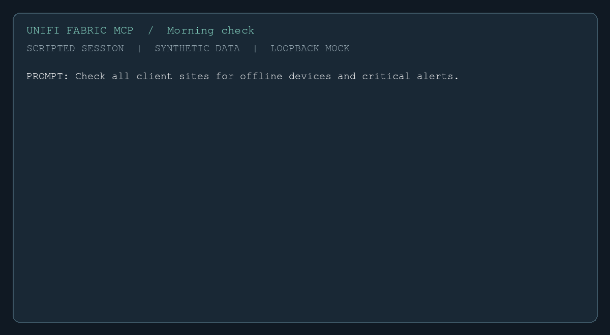
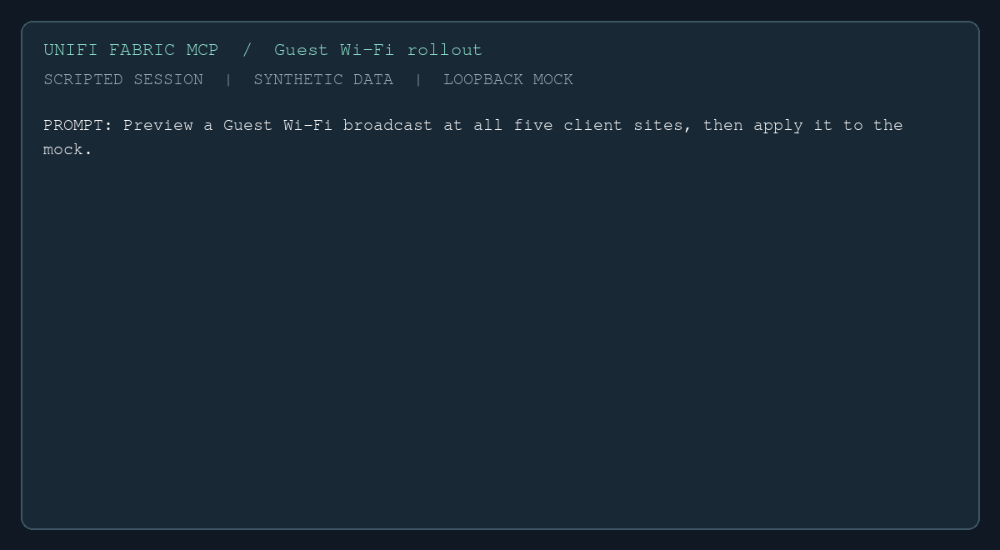
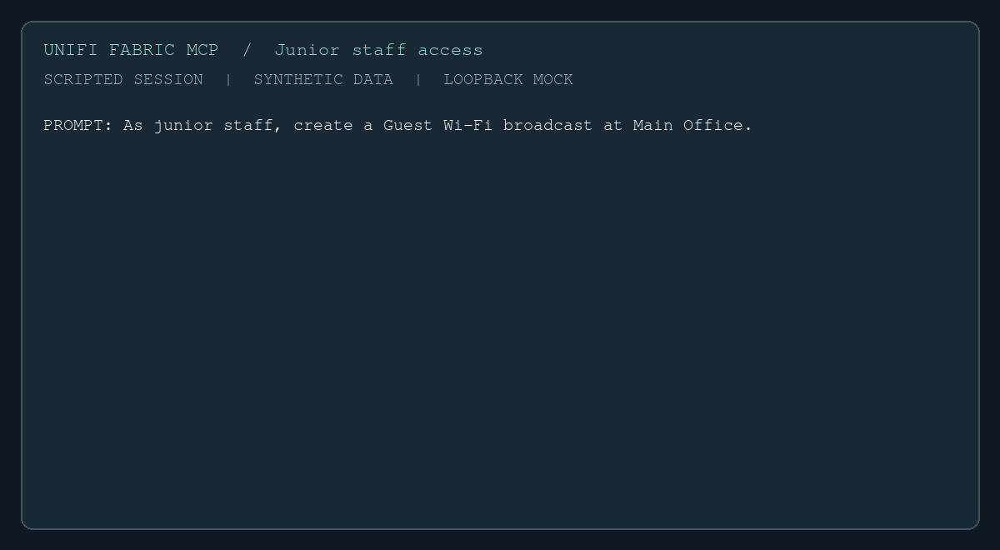

# MSP workflows

UniFi Fabric MCP can work across multiple client accounts from one MCP server. Configure
a key for each account, ask for a fleet-wide view, and use a separate read-only server
for staff who should investigate without making changes.

## Connect client accounts

Set `UNIFI_API_KEYS` to a JSON array. Each label is unique and identifies a key in
tool results; `is_org_key` identifies an organization key when applicable.

<!-- doc-provenance: source=file:src/unifi_fabric/config.py@sha256:5e8bcdf0f74c062cdd783f0630fd37548419f5b233c5a46c149c958657b996b3 support=0.7.0 citation=file:src/unifi_fabric/config.py@sha256:5e8bcdf0f74c062cdd783f0630fd37548419f5b233c5a46c149c958657b996b3 -->
```json
[
  {"key": "YOUR_EAST_KEY", "label": "east", "is_org_key": true},
  {"key": "YOUR_WEST_KEY", "label": "west", "is_org_key": true}
]
```

Supply the JSON as the `UNIFI_API_KEYS` environment variable in your MCP client or
server deployment. Store actual keys in your secret manager and grant each only the
access it needs. `UNIFI_API_KEY` is the single-key shorthand. The server aggregates
supported fleet tools across keys and routes per-host operations to the key that owns
the console. Results identify their key with `_keyLabel`; a failed key is reported
alongside successful results. See [multi-key configuration](CONFIGURATION.md#multi-key-msp-setup)
for details and limitations.

## Three scripted demonstrations

These recordings are scripted examples, not live AI sessions. They use invented sites,
synthetic keys and a loopback mock. Every displayed result comes from real MCP calls to
the server. The rollout applies only to the mock. The exact prompts are shown below;
an assistant may choose different tools or wording in a live session.

### Morning check

> Check all client sites for offline devices and critical alerts.



The script calls `list_sites` and `list_devices`, identifies offline devices and
reports the critical notification count supplied in site statistics. These are counts,
not a detailed alert feed.

### Guest Wi-Fi rollout

> Preview a Guest Wi-Fi broadcast at all five client sites, then apply it to the mock.



With `UNIFI_DRY_RUN=1`, five `create_wifi_broadcast` calls return previews and no
write reaches the mock. A separate server session then applies five calls to the mock.
The mock accepts those writes in memory only. In a real deployment, review each
preview, network assignment, security configuration and site before taking action.
Dry-run applies to the whole server process; applying requires a separate session with
dry-run disabled. Writes are enabled by default.

### Junior staff access

> As junior staff, create a Guest Wi-Fi broadcast at Main Office.



A server started with `UNIFI_READ_ONLY=1` refuses the write before contacting the
mock. With `UNIFI_AUDIT_LOG` set, the recording shows the actual refusal record.
Read-only mode is a server-wide control, not a per-user role: give junior staff a
separately configured server and protect access to any write-enabled server.

## Audit and operating controls

Set `UNIFI_AUDIT_LOG` to a writable file path, or `/dev/stderr` for a container,
and optionally set `UNIFI_AUDIT_LOG_FORMAT=json`. The server records write attempts
and refusals without request bodies or keys. Logging is best effort: a log write
failure produces a warning and does not stop the call. Restrict access to logs and
arrange collection and retention in your deployment. See
[configuration](CONFIGURATION.md) for read-only mode, dry-run, audit fields and
additional write controls.

To reproduce the recordings and verify their assertions, follow
[the MSP demo instructions](../scripts/demo/README.md#msp-demonstrations).
